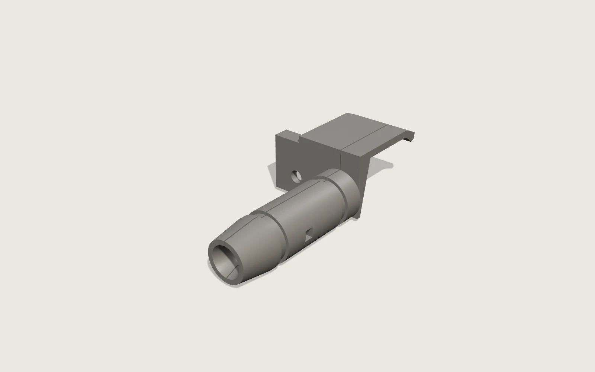

# Laptop charger brace

Two printed halves that clamp the barrel plug of an Alienware m15 R7 charger and hook over the
laptop's rear bar, so a knock on the cable loads the bar instead of the jack.

**Status: modelled as v1, ready for a test print.** The laptop and the plug are caliper
measured; every size of the brace itself is a proposal. The first print is the fit test — how
the bore grips the plug body, and how the hook sits in the laptop's rear trough.



## What it is

The plug is a barrel jack on a stiff cable, standing 52 mm out of the rear face. Anything that
pushes the cable works that barrel against the socket. The brace wraps the plug's body in a
16.4 mm shell, carries a plate up the sloping rear face, and ends in a hook that reaches 5 mm
past the ridge of the rear bar and is shaped to the curve of the trough behind it.

It prints as two halves split along the plug's axis, and closes **around** the plug rather than
sliding over it — the hook on the laptop side would otherwise have to be forced through a closed
socket. Two cable ties in grooves at 12 mm and 39 mm pull the halves together onto the body, and
a 1.75 mm filament pin through each half stops them sliding against each other. The halves are
left 0.3 mm apart so the ties have something to take up.

The plate is deliberately lopsided — 26.25 mm towards the HDMI port, 7.25 mm towards the vent —
because the vent is right there and the plate must not cover it.

## How much it holds

Calculated, **not measured**, on the drawing's sheet 02:

| Load | Holds | Note |
|---|---|---|
| Straight pull on the plug | 26 N | What it takes to climb the hook lip back up the slope |
| Push down at the mouth | 10 N | Tips about the foot of the plate |
| Push up at the mouth | 14 N | Where the arm's root bend reaches 30 MPa |
| Push sideways, towards the vent | 6 N | The weak direction: only 7.25 mm of plate on that side |
| Push sideways, towards the HDMI port | 12 N | Twice as good, twice the plate |

Worst-case stress in the shell is about 7 MPa at a tie groove against roughly 40 for printed
PETG along its layers, so the shell is not the limit — the hook's grip is. One number is still
missing: how hard the cable's own bend pushes, which is **HH** on the drawing and wants a
kitchen scale.

## Parts

| File | What it is | Grams |
|---|---|---|
| [`models/arm-2.4-vent-half.stl`](models/arm-2.4-vent-half.stl) | The half on the vent side | 4.6 |
| [`models/arm-2.4-hdmi-half.stl`](models/arm-2.4-hdmi-half.stl) | The half on the HDMI side, with the hook arm | 7.0 |
| [`models/arm-2.4-both-halves.stl`](models/arm-2.4-both-halves.stl) | Both, laid out on one plate | 11.6 |
| `models/arm-3.0-*.stl` | The same, with the arm 3.0 mm thick instead of 2.4 | 12.2 |

The arm is the piece that lies on top of the rear bar and springs over its ridge. 2.4 mm is the
drawn size; 3.0 mm is there because the spring force is a calculation and not a measurement, and
one of the two will feel right in the hand. Print both and keep the one that does.

Solid PETG at 1.27 g/cm³, so about 12 g of filament for the pair — this is a part you can afford
to print three times.

## What you have to buy

- **Two cable ties**, 3 mm wide or narrower.
- A **1.75 mm filament offcut** for the two alignment pins.

## Print settings

PETG, 0.16 mm layers, 4 walls, 40 % infill, no supports, 100 % scale. Print both halves split
face **down** on the bed, so the arm's layers run along its length rather than across it — that
arm springs every time the brace goes on.

## Rebuilding the models

```bash
pip install manifold3d trimesh numpy scipy
python src/build_charger_brace_v1.py models
```

Variable names are the blueprint's letters, so a size on the drawing traces to the line that
uses it. The script builds in the blueprint's `(u, y, z)` and then takes `X = -u`: those
measurement axes are left-handed, and without the minus sign the plate comes out over the vent.
Do not remove it.

[`src/charger_brace_blueprint_sheet01_generator.py`](src/charger_brace_blueprint_sheet01_generator.py)
draws the printable sheet in [`renders/`](renders).

## The drawings

- [`blueprint.html`](blueprint.html) — sheet 01: the plug and the rear port, everything measured.
- [`part-sheet.html`](part-sheet.html) — sheet 02: the brace itself, every size a proposal, with
  the load figures above.
- [`sheet-01-print.html`](sheet-01-print.html) — the same sheet 01 laid out for paper, with the
  PDF and PNG in [`renders/`](renders).

## What is still open

- Nothing has been printed. The bore clearance over the plug body (0.2 mm relief on the bump)
  and the hook's fit in the trough are both guesses until the first fit test.
- The rear face is drawn as a straight 5 mm slope over its 23 mm height. The real face may be
  curved; the fit test settles it.
- The trough behind the ridge is drawn as a cosine curve, marked ASSUMED on sheet 01.
- The screw beside the jack has a 4.4 mm clearance hole over it, but its head was never measured.
- **HH** — the force the cable's own bend puts on the plug.

## Licence

Models, drawings and renders: CC BY-SA 4.0. The build script: MIT. See
[LICENSE](../../LICENSE) and [LICENSE-models.md](../../LICENSE-models.md).
