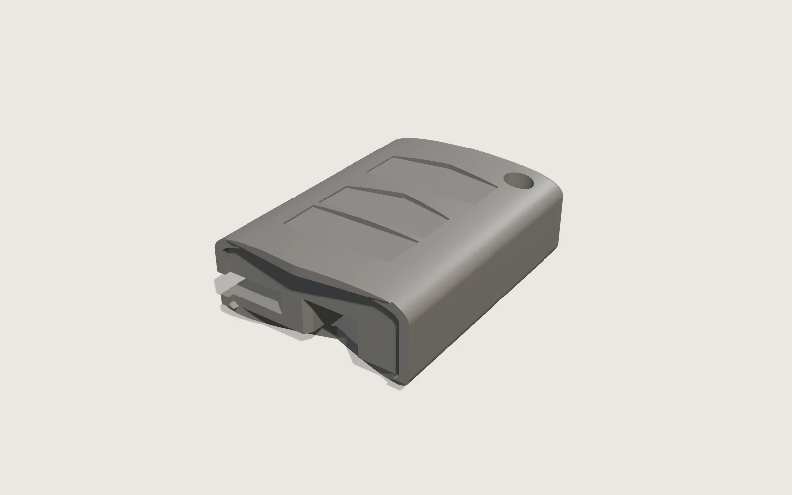

# Mazda flip key — replacement remote body

A printed replacement body for a 2007 Mazda Atenza flip key. The original metal head — blade,
rivet and folding mechanism — is reused; the printed part is the plastic shell that closes
around its tab, in two halves glued together.

**Status: v4 modelled, not yet printed.** v3 was printed and fit-tested on 9 October 2026 and
came out mirrored. v4 is the corrected build and has not been in anyone's hand.



## Why there is a blueprint at all

This is the print that started the method. The first body was built from photographs and
estimates and did not fit. It only came right once there was a labelled drawing with every
caliper reading on it — see [METHOD.md](../../METHOD.md). The drawing is
[`blueprint.html`](blueprint.html): sheet 01 is the metal head, measured; sheet 02 is the body.

## What it is

The head is 31.90 mm across and 15.80 mm thick, measured from the dome tip down. Its tab is
7.04 mm wide, 5.50 mm thick and 14.60 mm long, offset 15.30 mm from the blade-side edge, with a
1.80 mm hook on it. The folded blade's tip sits 62.46 mm from the dome tip, in a 3.60 mm gap.
Every one of those is a caliper reading, listed in the drawing's schedule.

The body is split on a plane parallel to its faces, at 10.2 mm through the tab socket, the hook
catch and the blade slot:

- the **rivet half** takes the head laid in it, logo face up, blade folded — the tab, hook, base
  and blade all drop into pockets that are open on the split face;
- the **logo half** lays on top and glues down over the skirt.

Two 2.0 mm holes take 1.75 mm filament pins to line the halves up. It is built this way, rather
than as one piece, because forcing a hook into a closed socket is how you break a part you waited
a week to collect.

The button panels are 0.8 mm recesses on the logo face. **There is no badge or logo artwork
anywhere in this repository** — the panels are blank, and that is deliberate.

The build also emits three fit-test variants of just the socket end, at 0.15, 0.25 and 0.35 mm
clearance per side, carrying one, two and three grooves respectively so they can be told apart
after printing.

## Handedness — read this before changing the script

v3 was modelled directly in the blueprint's coordinates and came out back to front, with the
blade slot on the wrong side. Those axes — x across the width, y through the thickness from the
rivet face, z along the key from the dome tip — are a **left-handed** set. v4 builds in the same
coordinates and then mirrors z exactly once. Nothing about it looks wrong on screen. It cost
three printed fit tests to find.

## The third-party cross-section — what is and is not published

The body's outer cross-section was taken from a downloaded TPU fob cover. **No licence or
author for that file could be found**, so the cover STL itself is not in this repository.

What the script does with it is narrow, and worth stating plainly so you can judge it: it takes
one planar section of the cover, reduces that to its convex hull, insets it 1.5 mm, and then
rescales the result to the 31.90 × 15.80 mm measured here. What survives is the corner curvature
of a rounded rectangle. Every dimension of the part — width, thickness, length, every pocket,
the split plane, the panels, the keyring — is an original measurement or an original design
choice, on the drawing.

So:

- **Published:** the drawing, the build script, the renders, and
  [`web/mazda-flipkey-body.glb`](web/mazda-flipkey-body.glb) for 3D views on the web.
- **Not published:** `Mazda_5_Fob_Cover.stl`.
- **Consequence:** the script cannot be run, and the printable STLs cannot be regenerated, without
  that file. The 3D views on the drawing show "3D VIEW UNAVAILABLE" for the same reason — the
  2D sheets are complete without them.

If you are the cover's author, open an issue and the derived geometry will be removed or credited
however you prefer.

The dependency can be cut altogether. The profile is a rounded rectangle; generating it from the
measured width, thickness and corner radii instead of from a downloaded mesh is about fifteen
lines, replacing the `cover.section(...)` block near the top of
[`src/build_mazda_body_v4.py`](src/build_mazda_body_v4.py). That has not been done yet, and this
note is here rather than quietly absent so the state of it is on the record.

## Rebuilding the models

```bash
pip install manifold3d trimesh numpy shapely scipy
python src/build_mazda_body_v4.py <cover.stl> models        # halves, both-halves plates, fit tests
python src/make_mazda_v4_glb.py  <cover.stl> models         # the page's 3D views
python src/mazda_key_blueprint_generator.py renders         # the key head drawing
```

Print settings when there is something to print: PETG, 0.16 mm layers, 4 walls, split face down.

## What is still open

- v4 has never been printed. The tab clearance is the whole question, which is what the three
  fit-test variants are for.
- Whether the glue joint holds against the twist of turning an ignition. Nothing about that is
  calculated.
- The cross-section's provenance, above.

## Licence

Models, drawings and renders: CC BY-SA 4.0, except as noted above for the cross-section. The
build scripts: MIT. See [LICENSE](../../LICENSE) and
[LICENSE-models.md](../../LICENSE-models.md).
